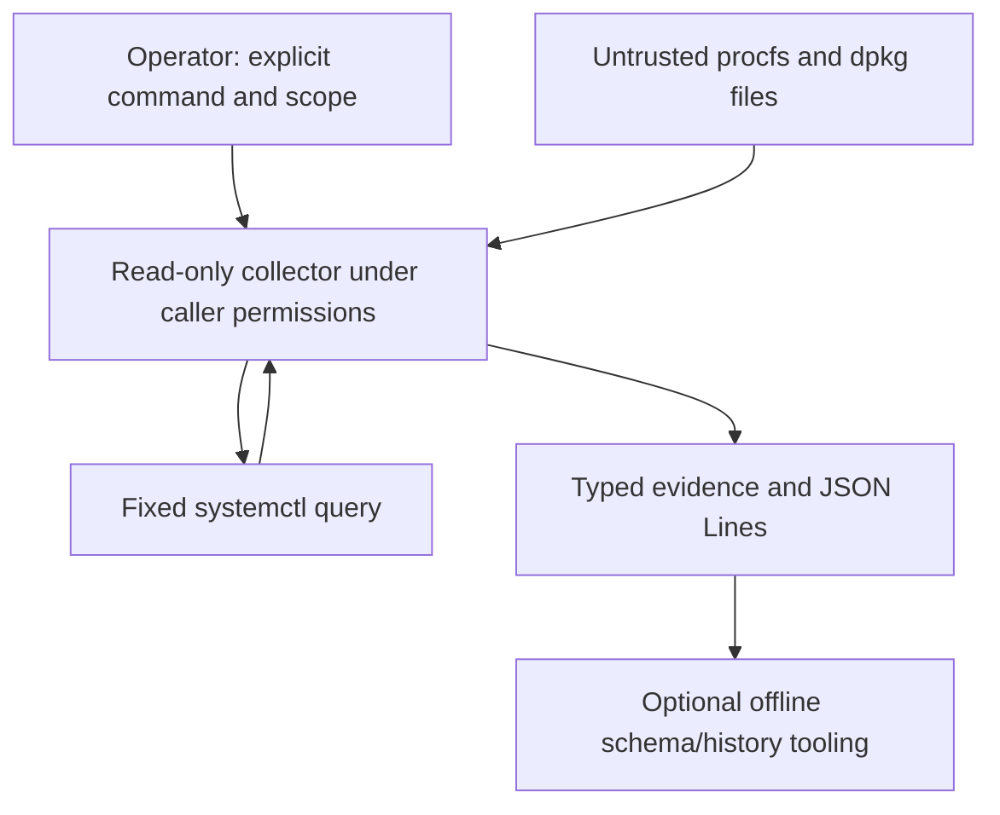

# Threat model — MIRA

> Scope (2026-10-30): implemented local Linux evidence collection, serialization/comparison, native tests and experimental CLI packaging. The retained simulation has separate authority/control limitations below. Future intent, AI, UI, remote and write adapters require a new review; this document does not certify the proposed full operations product.

## Linux operations boundaries

- **Host evidence boundary:** procfs, systemd, journal, package databases and advisories may be stale, malformed, attacker influenced or inaccessible. Treat them as observations, never commands; bound reads, parse strictly, report collection failures.
- **Privilege boundary:** run as an ordinary user, never escalate automatically, avoid arbitrary shell and executable plugins; added privileged functionality requires a separate reviewed helper and explicit authorization.
- **Intent boundary:** natural language must only select admitted capabilities; it never grants them. AI-produced action plans are untrusted proposals.
- **Adaptive UI boundary:** only registered display components and scoped actions can be composed; never execute model-generated JavaScript or shell commands.
- **Vulnerability evidence boundary:** identifiers and upstream package versions alone do not prove exposure on Ubuntu; correlate distribution backports, package provenance and runtime applicability, preserving unknown states.
- **External inference boundary:** local is default; hosted AI receives only deliberately released synthetic/public inputs, has bounded budget and no direct execution access.
- **Future execution boundary:** remediation is out of scope for the MVP. Before adding writes, require scoped grants, operator confirmation, preconditions, independent postcondition verification and a recovery design.

### Current operational data flow



The executable search environment is supplied by the caller. Files, systemd output and stored captures cross untrusted-data boundaries; none can grant execution authority. Historical captures have no authenticated host identity or chronology.

### Collector and package controls

The systemd child uses fixed argv, closed stdin, no shell and no privilege escalation. A nonblocking local socket and one deadline cover execution and stdout EOF, including inherited writers after direct-child exit. Output is capped at 8 KiB and the direct child is reaped on every post-spawn return path. This bounds collection, not arbitrary descendant execution. The admitted production executable remains systemctl resolved through the caller's trusted PATH; the caller's environment is not an authentication boundary.

Selection and error flags do not erase installed-package provenance. Local dpkg records and build-distribution ELF dependency metadata are unauthenticated inputs. Package assembly derives versioned ABI dependencies with dpkg-shlibdeps and normalizes its umask; repeated assembly compares one binary under different invoking masks, not independent clean compilations. Native Cargo subprocess fixtures are admitted only by the non-default test-support feature and are excluded from the package. They substitute a per-child PATH, never the test process environment; their inherited writer has a finite five-second lifetime. Python schema/history tooling is separate from the Rust CLI and native suite. These checks do not establish signed provenance, clean-system dependency resolution or an unattended collector sandbox.

### Operational acceptance checks

1. Malformed, missing, oversized and contradictory Linux evidence cannot become a confirmed finding.
2. Read-only inspection does not mutate host state or trigger network/model operations.
3. Stale advisories, absent package provenance and uncertain backport status must produce *unknown*, not *affected* or *fixed*.
4. UI layout/model-output changes cannot add unregistered execution capabilities.
5. Remote/privileged adapters are rejected until separately modeled and authorized.


Status: v0.1 design baseline, 2026-10-30. Review at each new trust boundary. This is a threat model, **not** a claim of security certification or control-system safety.

## Retained simulation: system and assets
The retained fixture coordinates a human and an autonomous participant in a deterministic Rust grid simulation. Inputs are caller-supplied proposals (`Actor`, `Move`, `tick`), optional time-bound grants, and scenarios. The engine applies an arbitration decision and records events in process memory. It has no built-in identity verification, network-facing APIs, persistent audit ledger, real robots, or LLM integration today.

Protect: integrity of simulation state and outcomes; validity of arbitration; availability and resource bounds; reliability of event records; source/CI integrity. Future extension assets include credentials, model requests, scenario provenance and user data.

## Retained simulation: trust boundaries and DFD

```text
 [Human input]             [Scripted / future LLM agent]
      |                                |
      | TB1 untrusted proposals        | TB1 untrusted proposals
      +------------+-------------------+
                   v
       [MIRA runner / coordination API]
                   |
          [mode + caller-supplied grant]
                   | TB2 authorization semantics
                   v
            [Arbitration engine] ----> [decision records]
                   |
                   | validated command (internal)
                   v
          [Deterministic simulation]
                   |
                   +----> [in-memory events / outcome]
                              |
                         TB3 export boundary
                         (future persistence/UI)
```

TB0: repository/CI dependency and workflow supply chain (outside runtime DFD). TB4: future hosted inference endpoint, outside the present implementation. A model's output must never be considered an authorized instruction merely because it conforms to a response schema.

## Assumptions and explicit limitations
- Caller-provided `Actor` is an assertion, not authenticated identity. A malicious caller who can invoke the library can claim either actor.
- `Grant` is supplied per step, actor-specific and expires at a tick; it is not a signed or unforgeable capability, lacks scope and revocation, and is not an external security boundary.
- `Engine::step` validates movement against the grid; this is simulation consistency, not a guarantee of physical safety.
- In-memory events enable comparison within one version; cryptographic tamper evidence, durable replay and cross-version equivalence are not implemented.
- Local use is trusted-process execution. No real-world actuator connectivity is permitted under the current design.
- LLM, web, identity and remote-user interfaces are future features only.

## STRIDE analysis

| Threat | Boundary / asset | Current state | Required mitigation before expansion |
|---|---|---|---|
| Spoofing: agent claims human role | TB1 / authority | Caller controls actor enum | Bind principal to an authenticated, transport-independent session outside the untrusted payload |
| Tampering: forged grants or proposals | TB1–TB2 / arbitration | Grant is caller supplied | Issuer-controlled scoped grant registry, revocation, nonces or bounded epochs; reject unrecognized principals |
| Repudiation: events altered after run | TB3 / provenance | Volatile in-memory trace | Versioned, canonical event representation and replay verification; cryptographic integrity if adversarial persistence is introduced |
| Information disclosure: model request leaks private state | TB4 / observations | No model adapter today | Redaction and data classification; synthetic-only hosted tests; local inference by default |
| Denial of service: excessive scenarios or proposal volume | TB1 / availability | Basic dimension and tick validation | Limits on grid size, obstacle count, run length, request size, time and resource budgets |
| Elevation of privilege: unauthorized actuation | TB2 / control | Modes and expiry, no real principal | Single non-bypassable execution gate, scoped authorization and negative tests |
| Prompt injection: hostile scenario/model content | TB1/TB4 / instructions | No LLM presently | Strict separation of data from commands, structured output validation, least-privilege tool access |
| CI compromise: untrusted code obtains workflow token | TB0 / repository | CI has read-only token | Pin third-party actions, avoid privileged PR triggers, audit permissions, retain branch review gates |

## Safety and control hazards (not interchangeable with STRIDE)
- H1: command applied contrary to human override. Constraint: override must take precedence under explicitly defined arbitration policy.
- H2: stale, duplicated or out-of-order proposal changes state. Constraint: only current-tick authorized proposals may execute.
- H3: collision, timeout and goal completion reported inconsistently. Constraint: terminal outcome precedence must be explicit and exclusive.
- H4: authority expires or transport fails mid-task and unsafe behavior persists. Constraint: fail closed / safe no-op until a new authorized decision.
- H5: assistance changes operator intent unexpectedly. Constraint: assistance policy and every accepted/rejected intervention must be inspectable.

These constraints are requirements for future assurance tests, **not verified guarantees** across all failure modes.

## Attack hypotheses and tests
1. Inject agent proposal labeled `Human`: current public API can be impersonated; document as a design limitation until authenticated principals exist.
2. Supply expired grant or a stale proposal: expect no agent movement, with recorded rejection.
3. Submit an out-of-bounds command: expect stationary state and explicit rejection.
4. Attempt an additional step after a terminal outcome: expect an error and immutable state.
5. Repeated and oversized scenarios: define strict resource limits before accepting remote inputs.
6. Attempt to substitute a hosted-model response into the arbiter without authorization: future adapter must not circumvent the execution gate.
7. Mutate recorded traces: future replay must detect mismatches under an explicitly versioned format.

## Data handling and sovereignty
Keep simulation and scripted baselines offline. Hosted inference (including GitHub Models) is an optional external trust boundary; only synthetic/public content is permitted by default. Document provider, region and access assumptions rather than equating EU hosting with legal/operational sovereignty. Never publish credentials, personal telemetry, model-provider secrets or private infrastructure details.

## Residual risk / release gates
Current v0.1 residual risk is **high if treated as an authorization or real-world control system** and bounded for its stated offline educational simulation use. Prior to adding external agents, persistent storage, browser-to-host bridges or physical hardware: revise the DFD, establish authenticated principals and scoped delegation, define replay/event schemas, apply size/time limits, fuzz parser and state transitions, and obtain independent design review.

Ownership: maintainers. Update this document with every material interface or authority change.
