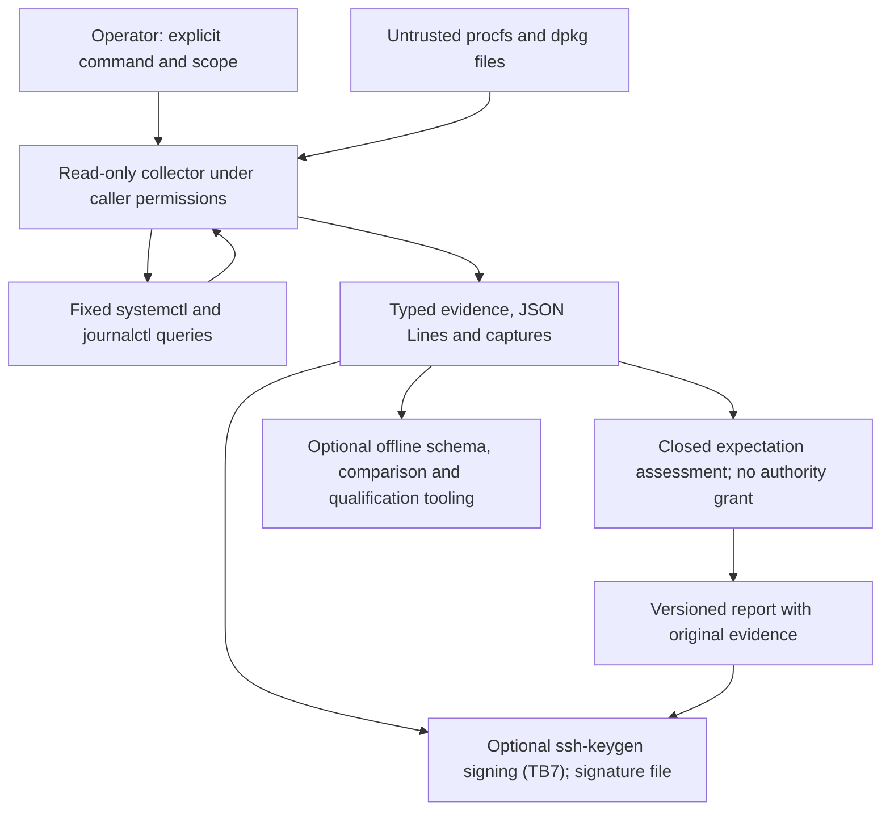
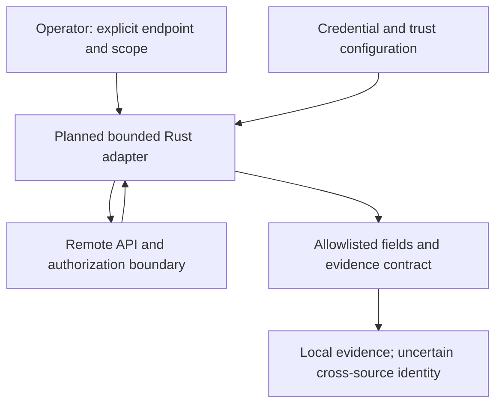

# Threat model — MIRA

> Scope (reviewed 2026-11-01): implemented local Linux evidence collection (procfs, dpkg, one selected systemd service, text-free journal event classes), seven closed expectation templates, captures and their offline comparison, signing and verification through `ssh-keygen`, consumer-challenge freshness, the host qualification runner, native tests and experimental CLI packaging. The retained simulation has separate authority/control limitations below. Future natural-language intent, AI, UI, remote and write adapters require a new review; this document does not certify the proposed full operations product.

## Linux operations boundaries

- **Host evidence boundary:** procfs, systemd, journal, package databases and advisories may be stale, malformed, attacker influenced or inaccessible. Treat them as observations, never commands; bound reads, parse strictly, report collection failures.
- **Privilege boundary:** run as an ordinary user, never escalate automatically, avoid arbitrary shell and executable plugins; added privileged functionality requires a separate reviewed helper and explicit authorization.
- **Intent boundary:** natural language must only select admitted capabilities; it never grants them. AI-produced action plans are untrusted proposals.
- **Adaptive UI boundary:** only registered display components and scoped actions can be composed; never execute model-generated JavaScript or shell commands.
- **Vulnerability evidence boundary:** identifiers and upstream package versions alone do not prove exposure on Ubuntu; correlate distribution backports, package provenance and runtime applicability, preserving unknown states.
- **External inference boundary:** local is default; hosted AI receives only deliberately released synthetic/public inputs, has bounded budget and no direct execution access.
- **Future execution boundary:** remediation is out of scope for the MVP. Before adding writes, require scoped grants, operator confirmation, preconditions, independent postcondition verification and a recovery design.

### Current operational data flow



Invalid UTF-8 arguments are rejected before dispatch with a fixed usage diagnostic; raw bytes are not printed. The executable search environment is supplied by the caller. Files, systemd and journal output and stored captures cross untrusted-data boundaries; none can grant execution authority. Unsigned captures have no authenticated producer, and no capture has a trusted wall-clock chronology. A signature names the key holder, same-boot ordering rests on reported boot IDs and uptime, and a consumer challenge bounds age on the consumer's clock; none of these makes the measurements true.

### Collector and package controls

Uptime parsing validates both unsigned decimal fields before emitting an observed value, including the unexported aggregate idle field. Malformed or overflowing input remains unavailable without suppressing independent sources; idle greater than uptime is valid on multicore hosts. This does not authenticate procfs.

Memory parsing admits only unsigned ASCII decimal tokens and ASCII separators in the retained MemTotal/MemAvailable fields. Malformed spellings cannot be normalized into an observed value or a satisfied memory expectation. Capture regressions preserve independent sources when memory is rejected; unretained meminfo fields remain outside this parser's semantic scope.

The systemd child uses fixed argv, closed stdin, no shell and no privilege escalation. A nonblocking local socket and one deadline cover execution and stdout EOF, including inherited writers after direct-child exit. Output is capped at 8 KiB and the direct child is reaped on every post-spawn return path. This bounds collection, not arbitrary descendant execution. The admitted production executable remains systemctl resolved through the caller's trusted PATH; the caller's environment is not an authentication boundary.

Selection and error flags do not erase installed-package provenance. Local dpkg records and build-distribution ELF dependency metadata are unauthenticated inputs. Package assembly derives versioned ABI dependencies with dpkg-shlibdeps and normalizes its umask; repeated assembly compares one binary under different invoking masks. A separate test compares fresh source/target compilations and selected artifacts under path/timezone/umask variations within one native runner/compiler environment; independent hosts and hermetic toolchains remain unqualified. Native Cargo subprocess fixtures are admitted only by the non-default test-support feature and are excluded from the package. They substitute a per-child PATH, never the test process environment; their inherited writer has a finite five-second lifetime. Python schema/history tooling is separate from the Rust CLI and native suite. The separate disposable-container apt test adds real dependency-resolution and installed-byte/CLI evidence; it does not establish physical-host or upgrade behavior, signed provenance or an unattended collector sandbox.

The native source-boundary matrix checks each of the seven pressure-profile sources at its exact byte budget, one byte over and with invalid UTF-8. It verifies source-specific failures and preserved independent observations through the capture path. These fixtures do not prove deadlines for arbitrary filesystems or representative host coverage.

The independent live procfs check compares kernel release and total memory against equal direct endpoint samples and brackets whole uptime. Schema-valid disagreements, required unavailable values and inconclusive endpoint changes fail CI. These are controlled unprivileged runner observations, not authenticated provenance or fleet qualification. The [qualification runner](qualification.md) reuses these validators on real hosts. Its receipt has a closed field list without host identifiers or sampled values; it is unsigned, its host class is operator-declared, and a wrongly absent capability probe could hide a check, so every unexpected not-applicable group or gap is a review finding. MemAvailable and PSI can fluctuate outside endpoint ranges; the check deliberately makes no such correlation claim and emits no sampled values.

### Capture admission and completeness

[ADR 0010](adr/0010-capture-timeline-and-freshness.md) stage 1 is implemented: opt-in `--timeline` emits capture-v2 with one monotonic window, per-source offsets and a fixed wall-clock consistency rule. Records are unchanged and no identifier is added. A forged timeline is caught only when internally inconsistent, unless the capture is signed ([ADR 0011](adr/0011-host-identity-and-capture-integrity.md)). Stage 2 is also implemented: explicit `--bind-boot` reads the boot ID (at most 64 bytes, strict UUID syntax) and centisecond uptime at both window edges. Any failure, a changed ID or a reversed window yields `unavailable` with no partial value. The boot ID links captures from one boot and container tenants on one host, so it is never collected by default and never enters capture-v1 or investigation reports. Stage 3 is implemented too: when both inputs carry a timeline (capture-v2 or capture-v3), comparison-v3 orders captures only when both report the same boot ID, and only when their uptime windows are strictly separated. Different IDs are reported as "different boot or host", never as a reboot. Order rests on reported procfs values, so an unsigned consistent forgery orders as claimed. Signatures (ADR 0011) and consumer challenges ([ADR 0014](adr/0014-consumer-challenge-freshness.md)) address authorship and age; trusted host time is not used. Its analysis covers forged timelines, procfs emulation and boot-ID linkability across captures and container tenants. The boot ID is never collected by default.

Capture-v1 uses an explicit operator label and closed source profile; neither is authenticated host identity. Evidence-v2 records add per-source monotonic elapsed time and fixed failure reasons without changing v1 exports. Missing PSI remains unavailable; no pressure threshold, trigger write or health inference is admitted. Completion means all requested results exist, not that observations are available, fresh or authentic.

Offline import opens nonblocking before descriptor validation, preserving symlink compatibility and caller responsibility for directory custody. Strict UTF-8, unique JSON keys, integer-only numeric tokens, bounded nesting and exact source coverage precede comparison. This prevents the tested FIFO replacement wait and ambiguous-key admission; arbitrary regular-file I/O still has no deadline or immutable snapshot guarantee. Decimal/exponent numeric tokens are rejected before floating-point conversion can change their meaning; valid integer tokens retain exact values. Failure-reason/error-kind consistency includes the io_failure fallback. Mismatched labels/profiles and mixed formats fail. Public captures can disclose operator-provided labels, so avoid sensitive identifiers. See [ADR 0002](adr/0002-complete-captures-and-admission.md).

### Investigation boundary

A closed enum selects service-active/v1 (also under the unversioned name) or the explicit service-active/v2 and validates one service scope before dispatch. Both versions share the same collector and evidence; v2 only adds the `unit_not_found` reason for a not-found/inactive unit. It uses the existing systemctl query and no additional verb. The report binds the requested scope to its embedded evidence and a local evidence pointer. The pointer and enum are not authenticated provenance or an OS sandbox. A single assessment enum determines outcome and fixed reason, so unavailable/transitioning/unsupported states cannot silently become success. LoadState remains orthogonal to activation. Neither a satisfied condition nor schema validity grants mutation, proves application health or identifies a root cause.

New report/schema consumers must preserve that distinction and reject unsupported versions. Existing evidence-v1 output remains separate. Errors expose no arbitrary backend message in reports; human state strings are escaped. The [decision record](adr/0001-read-only-service-investigation.md) records alternatives, scope, rollback and the state-table/alias/error validation. Generic command classification, audit chains, durable stores and background supervision remain outside this increment.

### Explicit memory expectation

memory-headroom/v1 admits only a positive ASCII integer KiB criterion of at most 20 digits fitting u64. It reads only the existing bounded meminfo source. A private report binds criterion, observation and derived outcome; no model, network, new file source, command or authority is introduced. Missing/malformed evidence stays indeterminate. MemAvailable is a changing kernel estimate, not workload/cgroup capacity, application health, allocation assurance or a remediation trigger. The local/procfs scope is not authenticated identity. A separate schema preserves existing service/evidence/capture contracts. See [ADR 0005](adr/0005-explicit-memory-headroom.md).

### Explicit pressure ceiling

pressure-ceiling/v1 admits only a closed resource name (`cpu`, `memory`, `io`) and an ASCII integer ceiling of at most five digits in 0..=10000 basis points; both are refused before acquisition. The resource selects one fixed PSI file through the existing closed `PressureResource` enum, so the operator cannot supply a path. It reads only that file through the existing 16 KiB bounded reader and ASCII-only parser, and adds no model, network, command or authority. A private report binds resource, criterion, observation and derived outcome. Missing PSI (a kernel without it, or `psi=0`), permission errors and malformed text stay indeterminate; they cannot satisfy even a 10000 ceiling. `some avg10` is a smoothed, lagging kernel ratio, usually system-wide inside containers. It is not workload health, a latency guarantee, root cause or a remediation trigger. The local/procfs scope is not authenticated identity. A separate schema embeds evidence-v2 and leaves existing contracts unchanged. See [ADR 0007](adr/0007-explicit-pressure-ceiling.md).

### Explicit package presence

package-installed/v1 admits only a Debian-policy package name and an optional exact architecture, refused before the database is opened. It reads only the existing bounded dpkg status source and validates the whole database, so a malformed stanza elsewhere cannot leave a partially trusted answer. Disclosure is limited to the selected name's records (at most 16), not the inventory. Version, architecture and status text are attacker-influenceable literals: JSON escapes them and human output prints them escaped. Only `installed` with flag `ok` satisfies; transitional and reinstall-required states stay indeterminate, and selection words cannot decide. The report carries `vulnerability_exposure: "not_assessed"`, because installed versions alone cannot establish exposure on Ubuntu (SEC-03). No dpkg/apt command, network, model or authority is added. See [ADR 0008](adr/0008-explicit-package-installed.md).

### Explicit uptime and kernel release

uptime-minimum/v1 admits only a positive ASCII integer of at most 20 digits; kernel-release/v1 admits only the collector's release syntax, untrimmed and starting with a letter or digit, so an option such as `--json` cannot become the criterion. Both are refused before acquisition. Each reads only its existing bounded procfs source and adds no model, network, command or authority. Missing or malformed evidence stays indeterminate. Uptime is time since boot, often the host's inside containers; it is not reboot cause, restart history or clock trust. The release string is a name, not a build identity, livepatch state, package state, patch-compliance or vulnerability verdict. The local/procfs scope is not authenticated identity. See [ADR 0009](adr/0009-explicit-uptime-and-kernel-release.md).

### Document integrity boundary

Stage 1 of [ADR 0011](adr/0011-host-identity-and-capture-integrity.md) is implemented: `mira` itself signs capture and investigation JSON with detached OpenSSH signatures (one namespace per document kind) and verifies them with `mira verify`. Stage 2 is implemented too: the comparator verifies the in-memory bytes it then parses and compares, so replacing a capture file after verification cannot change what is compared. A separate `mira verify` followed by a reopen would have had that check-then-use gap, which a security review demonstrated. This adds a new execution boundary (TB7), fixed-argument, shell-free `/usr/bin/ssh-keygen -Y sign/check-novalidate/verify` calls whose exit status and bounded signature bytes alone are trusted, and MIRA's first file write: an exclusively created signature file. The self-check runs on a staged copy in a fresh 0700 directory, and the output is created only afterwards and never unlinked or reopened by name, so a swapped parent directory cannot redirect cleanup (shown by a security review of an earlier draft). The analysis covers what a signature does and does not prove (key possession, not truth or freshness), replay of valid old captures, key custody and revocation, principal disclosure, and failing closed when the tool is missing. The test-only tool override exists only in `test-support` builds, and CI checks that the release binary does not contain it. The `systemctl` query and the `ssh-keygen` calls share one bounded runner (deadline, stdout limit, always reaping the direct child), so the reviewed subprocess handling applies to both.

Stage 1 of [ADR 0014](adr/0014-consumer-challenge-freshness.md) is implemented: `mira challenge` issues a 256-bit challenge from `/dev/urandom` with the issuer's wall-clock time, `capture --challenge` (signing required) reads it before collection and emits capture-v3 with the challenge at a fixed prefix, and `mira verify --challenge-file --max-age-ms` checks the signature first, then the prefix and an age bound on the verifier's own clock. No host clock is trusted. A pass bounds when a key holder running unmodified MIRA produced the capture; it does not make the measurements true. Replay of an older capture fails as `not_challenged` or `challenge_mismatch`; reuse of one challenge for several captures is the consumer's choice. The challenge file is trusted input that the consumer must protect, and it is read nonblocking, bounded and only as a regular file. Clock offset between an issuing and a verifying machine enters the bound, and only a negative age is detected (`issued_in_future`). The test-only random-source override exists only in `test-support` builds, and CI checks the release binary for it. Stage 2 is implemented as well: the comparator admits capture-v3 under the capture-v3 schema, and with `--before-challenge`/`--after-challenge`/`--max-age-ms` (trust options required) it checks each side's fixed prefix and parsed member against its own challenge-v1 file, requires distinct challenges and bounds both ages on its own clock. Duplicate keys are refused while parsing, so a second `challenge` member cannot disagree with the prefix.

### Journal event boundary

Implemented ([ADR 0012](adr/0012-bounded-journal-events.md)): MIRA reads journal entries for three closed event classes by catalog `MESSAGE_ID`, through a fixed `journalctl` argv under the shared bounded runner. It exports only counts, bounded validated unit names and boot-relative times, and never message text, PIDs, command lines, executable names or the boot ID. Partial journal access returns exit 0 with fewer entries, so a PID 1 sentinel must be visible, and every system journal file must be openable (access is per file ACL), before "none recorded" can be reported. journald rate limits and rotation mean that absence stays weak evidence, and the journal is attacker-influenceable TB2 input. Each catalog `MESSAGE_ID` is bound to its actual producer's journald-set fields: `_UID=0` with the systemd executable for manager messages (including systemd-oomd kills), and the systemd-coredump executable with its slice, matched in the query, and a cgroup-derived `systemd-coredump@` unit for crashes (backtrace reports are excluded because they cannot be bound). `_EXE` alone is not trusted, because an allowed binary can be run with injected code. Any producer-valid entry is conclusive, and only a full window without one is indeterminate, so decoys can at most cause "cannot tell". Neither unprivileged users (already excluded from `--system`) nor other system services can forge counted events; root can. The journalctl tool path and the journal-directory and procfs-root overrides exist only in `test-support` builds; CI checks that the release binary does not contain them.

### Planned shared workspace boundary

Status: design accepted ([ADR 0015](adr/0015-shared-mixed-initiative-workspace.md)). Stage 1a is implemented ([guide](sessions.md)):
- a signed, append-only log under the namespace `mira-session-v1@rmednitzer.github.io`
- entries accepted only in their exact canonical bytes, by a strict flat parser
- roles taken from the operator-signed header
- each entry and its signature published together as one record by an exclusive hard link, after the pending signature has verified for the writing principal, so readers never see partial entries
- notes with no control or bidirectional characters
- a close receipt, which must be outside the session (resolved through links), that `verify --expect-close` checks
- no session ID in any command output
- `verify` takes the expected operator from the verifier (`--operator`), never from the header, so a listed agent or collector key cannot pass off a counterfeit session in which it names itself operator
- without a receipt, `verify` cannot tell an older genuine session by the same operator from the current one

Stage 1b adds the broker:
- agents submit only signed requests to `inbox/`
- `mira session run`, started by the operator, verifies them and enforces level, budget and the closed capability set against the state at append time, so a directive takes precedence
- admitted actions run as MIRA itself, with a fixed argument vector built from a capability table whose tokens never start with `-`
- results are signed with a collector key that the broker checks before starting
- `verify` checks every relayed request against the agent's stored, agent-signed record. Each result document is checked against the collector's signature that the collector-signed result entry itself carries, so a different genuine document cannot be substituted
- close requires every action to have a result or an operator-signed `abandon` entry, so no result can follow the immutable close
- `verify` checks relayed requests and documents against the same authenticated in-memory log, never a second read that a concurrent writer could have replaced; external receipts are owner-only
- every agent-attributable entry (relayed request or refusal) costs budget, and the last 64 entries are reserved for the operator and results, so an agent cannot fill the log and block stop or close
- signature files are created at most 0644 whatever the umask, so a group-shared `documents/` never lets the agent open one for writing
- `start --separation separate_user` checks the parent's ancestry before creating anything and changes group and mode only on real, self-created directories; the broker and `act` resolve the session path once and use only the canonical path
- the broker pins the session directory's identity, refuses under `separate_user` any ancestor another user could rename through (including any directory owned by another user, whatever its mode), and acts only on a log extending the prefix whose signatures it verified, checked on the same read each append decides on
- the agent-writable `inbox/` is read with hard caps per pass (4,096 directory entries, 64 requests), and non-request objects, stale pending files and empty directories are purged. Disk exhaustion by the agent's user is outside MIRA's control: a quota on that user is a deployment requirement
- `separate_user` gives the agent's group read access to the log and write access to `inbox/` only, and the broker refuses inbox files owned by its own user

Agent containment holds only under `separate_user` with a collector key the agent cannot read. A two-user deployment is not exercised in CI. TB8 is the agent principal: an untrusted process with its own signing key, under its own OS user. It can only submit signed requests. An operator-run broker, which it does not control, executes them and signs every result with a collector key the agent cannot use.

| Plausible threat | Planned control and verification |
|---|---|
| Prompt injection through host evidence (journal unit names, dpkg strings, service states) steering the agent | The agent reads untrusted, private data, so under the Rule of Two it has no state-changing or communicating capability. Its actions are the closed read-only set, enforced by `mira`. Hostile-content fixtures must show that it cannot widen capabilities or post a false checked claim |
| Agent claims the operator role, forges a decision, or fabricates a result | Roles come from the operator-signed header. Every entry is signed under its own namespace and verified against the operator's `allowed_signers`. Only collector-signed results count as evidence. Under `separate_user`, the agent cannot write the log or documents or use the operator or collector keys, and a modified agent-side `mira` gains nothing |
| Excessive agency or runaway acquisition | Autonomy level, budget and expiry come from operator directives and are checked on every entry. `stop` takes precedence. Each action is already bounded |
| Over-reliance on persuasive or wrong agent output | Closed claim vocabulary; checkable claims verified at append time; inference labelled with confidence; bounded, escaped, unchecked notes; optional forcing; measured in stage 3 |
| Session tampering (deleting entries, removing the close, reading keys) | `separate_user`, required for model agents, makes the log unwritable by the agent. Signatures and sequence numbers detect modification, replay and gaps. An external close receipt detects truncation or a removed close. `same_user` sessions are labelled "not separated" and limited to trusted scripted agents |
| Host evidence leaking to a hosted model | Real sessions use local models only; hosted models see synthetic or public sessions only; `mira` itself never calls a model |
| MCP tool poisoning, rug pulls or cross-server shadowing | Agent access goes through a stdio-only adapter whose tool definitions are fixed, versioned and hashed into the session header. The MIRA client host connects the model to that adapter only, because any additional server could add an external channel. The broker re-checks every request |
| tmux used as a shared agent terminal | Never an agent interface: a writable client types into the operator's shell, a read-only client sees everything. The tmux server stays private to the operator's user |

These are design hypotheses, not verified controls.

### Planned platform observation boundary

Status: design constraints only; no remote adapter, credential loading or network request is implemented. [ADR 0004](adr/0004-staged-platform-observation.md) and the [integration plan](platform-integrations.md) require a separate implementation review.



| Plausible threat | Planned boundary control and verification |
|---|---|
| Spoofing or wrong cluster/node | Explicit endpoint and target binding, verified TLS, no default-context fallback; wrong-target and certificate failure fixtures |
| Tampered/stale API evidence or repudiated provenance | Versioned source/object identifiers and timing, preserve partial/unknown results; conflicting identifiers and version fixtures; unsigned evidence is not independent attestation |
| Credential or personal/infrastructure data disclosure | Explicit credential loading, reject executable auth configuration, exclude secret-bearing resources/fields, redact output and diagnostics; hostile response and credential-leak tests; API read exposure must also be justified |
| Denial of service from lists, pagination or reconnects | Total deadline, byte/object/page/request and retry budgets; truncation, rate-limit and timeout tests; no unbounded watches |
| Elevation of privilege through apparently read-only calls | Exact method/resource and permission allowlists; exclude proxy/exec and mutation paths; no admin fallback; assert outbound requests in disposable targets |
| Privacy linkage across host, workload and node records | Minimize identifiers/retention, deliberate local export, no hosted telemetry by default; inspect emitted fields and require a deployment data-custody review |

These are hypotheses and admission criteria, not observed attacks or verified controls. Kubernetes RBAC and Talos roles are distinct authorization systems; access to one does not establish access to the other. A read-only role can still expose sensitive data. No hosted provider or target fleet sovereignty assessment is established by this plan.

### Operational acceptance checks

1. Malformed, missing, oversized and contradictory Linux evidence cannot become a confirmed finding.
2. Read-only inspection does not mutate host state or trigger network/model operations.
3. Stale advisories, absent package provenance and uncertain backport status must produce *unknown*, not *affected* or *fixed*.
4. UI layout/model-output changes cannot add unregistered execution capabilities.
5. Remote/privileged adapters are rejected until separately modeled and authorized.


Status: v0.1 design baseline, 2026-10-30. Review at each new trust boundary. This is a threat model, **not** a claim of security certification or control-system safety.

## Retained simulation: system and assets
The retained fixture coordinates a human and an autonomous participant in a deterministic Rust grid simulation. Inputs are caller-supplied proposals (`Actor`, `Move`, `tick`), optional time-bound grants, and scenarios. The engine applies an arbitration decision and records events in process memory. It has no built-in identity verification, network-facing APIs, persistent audit ledger, real robots, or LLM integration today.

Protect: integrity of simulation state and outcomes; validity of arbitration; availability and resource bounds; reliability of event records; source/CI integrity. Future extension assets include credentials, model requests, scenario provenance and user data.

## Retained simulation: trust boundaries and DFD

```text
 [Human input]             [Scripted / future LLM agent]
      |                                |
      | TB1 untrusted proposals        | TB1 untrusted proposals
      +------------+-------------------+
                   v
       [MIRA runner / coordination API]
                   |
          [mode + caller-supplied grant]
                   | TB2 authorization semantics
                   v
            [Arbitration engine] ----> [decision records]
                   |
                   | validated command (internal)
                   v
          [Deterministic simulation]
                   |
                   +----> [in-memory events / outcome]
                              |
                         TB3 export boundary
                         (future persistence/UI)
```

TB0: repository/CI dependency and workflow supply chain (outside runtime DFD). TB4: future hosted inference endpoint, outside the present implementation. A model's output must never be considered an authorized instruction merely because it conforms to a response schema.

## Assumptions and explicit limitations
- Caller-provided `Actor` is an assertion, not authenticated identity. A malicious caller who can invoke the library can claim either actor.
- `Grant` is supplied per step, actor-specific and expires at a tick; it is not a signed or unforgeable capability, lacks scope and revocation, and is not an external security boundary.
- `Engine::step` validates movement against the grid; this is simulation consistency, not a guarantee of physical safety.
- In-memory events enable comparison within one version; cryptographic tamper evidence, durable replay and cross-version equivalence are not implemented.
- Local use is trusted-process execution. No real-world actuator connectivity is permitted under the current design.
- LLM, web, identity and remote-user interfaces are future features only.

## STRIDE analysis

| Threat | Boundary / asset | Current state | Required mitigation before expansion |
|---|---|---|---|
| Spoofing: agent claims human role | TB1 / authority | Caller controls actor enum | Bind principal to an authenticated, transport-independent session outside the untrusted payload |
| Tampering: forged grants or proposals | TB1–TB2 / arbitration | Grant is caller supplied | Issuer-controlled scoped grant registry, revocation, nonces or bounded epochs; reject unrecognized principals |
| Repudiation: events altered after run | TB3 / provenance | Volatile in-memory trace | Versioned, canonical event representation and replay verification; cryptographic integrity if adversarial persistence is introduced |
| Information disclosure: model request leaks private state | TB4 / observations | No model adapter today | Redaction and data classification; synthetic-only hosted tests; local inference by default |
| Denial of service: excessive scenarios or proposal volume | TB1 / availability | Basic dimension and tick validation | Limits on grid size, obstacle count, run length, request size, time and resource budgets |
| Elevation of privilege: unauthorized actuation | TB2 / control | Modes and expiry, no real principal | Single non-bypassable execution gate, scoped authorization and negative tests |
| Prompt injection: hostile scenario/model content | TB1/TB4 / instructions | No LLM presently | Strict separation of data from commands, structured output validation, least-privilege tool access |
| CI compromise: untrusted code obtains workflow token | TB0 / repository | CI has read-only token | Pin third-party actions, avoid privileged PR triggers, audit permissions, retain branch review gates |

## Safety and control hazards (not interchangeable with STRIDE)
- H1: command applied contrary to human override. Constraint: override must take precedence under explicitly defined arbitration policy.
- H2: stale, duplicated or out-of-order proposal changes state. Constraint: only current-tick authorized proposals may execute.
- H3: collision, timeout and goal completion reported inconsistently. Constraint: terminal outcome precedence must be explicit and exclusive.
- H4: authority expires or transport fails mid-task and unsafe behavior persists. Constraint: fail closed / safe no-op until a new authorized decision.
- H5: assistance changes operator intent unexpectedly. Constraint: assistance policy and every accepted/rejected intervention must be inspectable.
  Current retained policy: Assisted mode substitutes a current, safe agent proposal only when the human's current proposal is unsafe, and it consults no grant. Selecting Assisted mode is therefore the operator's standing consent to that substitution, and every substitution is recorded as `SafeAssistance`. Absent or stale human proposals never trigger substitution. In Delegated mode, by contrast, an agent acts only under an unexpired agent grant and only when there is no current human proposal; a stale human proposal does not block delegation. `tests/arbitration.rs` pins both behaviors. Changing either requires a design decision, not a test update.

These constraints are requirements for future assurance tests, **not verified guarantees** across all failure modes.

## Attack hypotheses and tests
1. Inject agent proposal labeled `Human`: current public API can be impersonated; document as a design limitation until authenticated principals exist.
2. Supply expired grant or a stale proposal: expect no agent movement, with recorded rejection.
3. Submit an out-of-bounds command: expect stationary state and explicit rejection.
4. Attempt an additional step after a terminal outcome: expect an error and immutable state.
5. Repeated and oversized scenarios: define strict resource limits before accepting remote inputs.
6. Attempt to substitute a hosted-model response into the arbiter without authorization: future adapter must not circumvent the execution gate.
7. Mutate recorded traces: future replay must detect mismatches under an explicitly versioned format.

## Data handling and sovereignty
Keep simulation and scripted baselines offline. Hosted inference (including GitHub Models) is an optional external trust boundary; only synthetic/public content is permitted by default. Document provider, region and access assumptions rather than equating EU hosting with legal/operational sovereignty. Never publish credentials, personal telemetry, model-provider secrets or private infrastructure details.

## Residual risk / release gates
Current v0.1 residual risk is **high if treated as an authorization or real-world control system** and bounded for its stated offline educational simulation use. Prior to adding external agents, persistent storage, browser-to-host bridges or physical hardware: revise the DFD, establish authenticated principals and scoped delegation, define replay/event schemas, apply size/time limits, fuzz parser and state transitions, and obtain independent design review.

Ownership: maintainers. Update this document with every material interface or authority change.

Schema/history tooling installs only the complete version/wheel-hash lock and refuses source builds. A changed-wheel negative test requires an actual hash mismatch before installation. These controls identify admitted artifact bytes, not uncompromised publisher identity. Fresh-build receipts preserve source/toolchain/artifact identity but are unsigned, share runner/system dependencies and are retained for only 30 days. See [ADR 0003](adr/0003-locked-tooling-and-fresh-builds.md).
